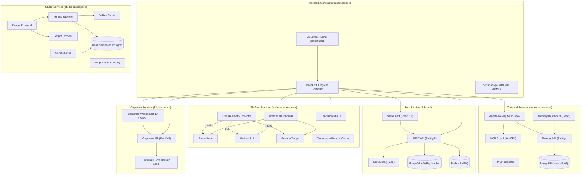

# Core Platform Monorepo (`@tupynambalucas-dev/platform`)

Core cloud-native platform monorepo powering the `tupynambalucas.dev` ecosystem, built on TypeScript, Fastify 5, React 19, pnpm Workspaces, and Turborepo with Kubernetes-native GitOps orchestration via Skaffold, Kustomize, Helm, and k3d.

> [!NOTE]
> **Documentation Hub:** Full architectural deep dives, Diátaxis guides, and tutorials are available at [https://docs.tupynambalucas.dev](https://docs.tupynambalucas.dev) and hosted sovereignly in the [`docs`](https://github.com/tupynambalucas-dev/docs) repository.

---

## 1. Architecture Overview

The codebase is partitioned into isolated **Bounded Contexts**, each owning its domain logic, TypeScript project references, infrastructure manifests, and lifecycle scripts. Multiple Skaffold profiles compose the local Kubernetes development environment across two isolated `k3d` clusters (`k3d-corporate` and `k3d-hub`), while `staging` and `prod` environments are delivered declaratively via ArgoCD GitOps.



```text
platform/
├── .agents/                 # Local Kubernetes plugin (.agents/plugins/k8s) and mesh bindings
├── corporate/               # Public-facing corporate web, REST API, and shared Zod domain contracts
│   ├── packages/core/       # @tupynambalucas-dev/corporate-core
│   ├── services/api/        # @tupynambalucas-dev/corporate-api
│   └── services/web/        # @tupynambalucas-dev/corporate-web
├── hub/                     # Internal engineering hub: Cortex AI gateway, Studio assets, observability
│   ├── cortex/              # @tupynambalucas-dev/cortex-* (MCP guardrails & vector memory)
│   └── studio/              # @tupynambalucas-dev/studio-* (Brand tokens, SVG assets, S3 bucket tools)
├── k8s/                     # Declarative Kubernetes manifests (Kustomize), Helm charts, Skaffold profiles
├── renderer/                # @tupynambalucas-dev/renderer (Document & asset compilation engine)
├── shared/                  # @tupynambalucas-dev/shared-* (ESLint, Prettier, TSConfig, Git hooks)
├── tools/                   # @tupynambalucas-dev/tools-* (GitHub CLI automation & provisioning)
├── AGENTS.md                # Sovereign Layer-1 AI agent context router
├── README.md                # Primary developer documentation
└── package.json             # Root monorepo manifest and pipeline scripts
```

---

## 2. Subsystems & Navigation

| Subsystem / Workspace         | Package / Scope                      | Documentation                                                              | Agent Context                                                              | Responsibilities                                                                                 |
| :---------------------------- | :----------------------------------- | :------------------------------------------------------------------------- | :------------------------------------------------------------------------- | :----------------------------------------------------------------------------------------------- |
| **`corporate/`**              | Corporate Domain                     | [`corporate/README.md`](./corporate/README.md)                             | [`corporate/AGENTS.md`](./corporate/AGENTS.md)                             | Public-facing corporate portal, Fastify 5 API, and shared domain schemas.                        |
| **`corporate/packages/core`** | `@tupynambalucas-dev/corporate-core` | [`corporate/packages/core/README.md`](./corporate/packages/core/README.md) | [`corporate/packages/core/AGENTS.md`](./corporate/packages/core/AGENTS.md) | Enterprise domain schemas, Zod validation models, and shared DTOs.                               |
| **`corporate/services/api`**  | `@tupynambalucas-dev/corporate-api`  | [`corporate/services/api/README.md`](./corporate/services/api/README.md)   | [`corporate/services/api/AGENTS.md`](./corporate/services/api/AGENTS.md)   | High-performance Fastify 5 REST API with Cloudflare Turnstile and rate limiting.                 |
| **`corporate/services/web`**  | `@tupynambalucas-dev/corporate-web`  | [`corporate/services/web/README.md`](./corporate/services/web/README.md)   | [`corporate/services/web/AGENTS.md`](./corporate/services/web/AGENTS.md)   | Customer-facing React 19 application with Three.js and GSAP animations.                          |
| **`hub/`**                    | Internal Hub                         | [`hub/README.md`](./hub/README.md)                                         | [`hub/AGENTS.md`](./hub/AGENTS.md)                                         | Internal engineering platform grouping Cortex AI, Studio, and observability.                     |
| **`hub/cortex`**              | `@tupynambalucas-dev/cortex-*`       | [`hub/cortex/README.md`](./hub/cortex/README.md)                           | [`hub/cortex/AGENTS.md`](./hub/cortex/AGENTS.md)                           | AgentGateway MCP proxy, CEL policy guardrails, and persistent vector memory.                     |
| **`hub/studio`**              | `@tupynambalucas-dev/studio-*`       | [`hub/studio/README.md`](./hub/studio/README.md)                           | [`hub/studio/AGENTS.md`](./hub/studio/AGENTS.md)                           | Canonical design tokens, SVG/PNG brand marks, typography, and R2/S3 asset tooling.               |
| **`k8s/`**                    | `@tupynambalucas-dev/k8s`            | [`k8s/README.md`](./k8s/README.md)                                         | [`k8s/AGENTS.md`](./k8s/AGENTS.md)                                         | Declarative Kubernetes manifests (Kustomize), Helm charts, and Skaffold profiles.                |
| **`renderer/`**               | `@tupynambalucas-dev/renderer`       | [`renderer/README.md`](./renderer/README.md)                               | [`renderer/AGENTS.md`](./renderer/AGENTS.md)                               | Dynamic document compilation engine and asset renderer.                                          |
| **`shared/`**                 | `@tupynambalucas-dev/shared-*`       | [`shared/README.md`](./shared/README.md)                                   | [`shared/AGENTS.md`](./shared/AGENTS.md)                                   | Cross-workspace ESLint, Prettier, TypeScript configs, and Git hooks.                             |
| **`tools/`**                  | `@tupynambalucas-dev/tools-*`        | [`tools/README.md`](./tools/README.md)                                     | [`tools/AGENTS.md`](./tools/AGENTS.md)                                     | Developer automation scripts, infrastructure provisioner, and GitHub CLI workflows.              |
| **`.agents/`**                | Agent Customizations                 | [`.agents/README.md`](./.agents/README.md)                                 | [`.agents/AGENTS.md`](./.agents/AGENTS.md)                                 | Local `k8s` domain plugin (`.agents/plugins/k8s`) and `@tupynambalucas-dev/agent-mesh` bindings. |

---

## 3. Environment & Secret Governance

The platform resolves secrets through **Infisical Cloud** (Universal Auth / CLI) or local `.env` files cloned from authoritative `.env.example` templates:

```bash
# Option A: Infisical CLI injection (Recommended)
infisical run --projectId <PLATFORM_PROJECT_ID> --env dev -- pnpm corporate:dev

# Option B: Local .env file fallback
cp k8s/.env.example k8s/.env
cp corporate/services/api/.env.example corporate/services/api/.env
cp corporate/services/web/.env.example corporate/services/web/.env
```

When operating inside the `org` umbrella meta-repository, secrets also cascade from the parent `org/.env` file or an active root Infisical session. In Kubernetes clusters, workloads consume secrets declaratively via `InfisicalSecret` custom resources.

---

## 4. Getting Started

### Prerequisites

- **Node.js**: `>= 22.x`
- **pnpm**: `12.6.0` (configured with strict Catalog mode)
- **Container Engine**: Docker Engine or Podman
- **Kubernetes Toolchain**: `k3d`, `kubectl`, `helm`, `skaffold` (pre-installed in the `tupynambalucas-dev-cluster` WSL2 distribution)

### Installation & Local Startup

```bash
# 1. Clone the repository using SSH
git clone git@github.com:tupynambalucas-dev/platform.git
cd platform

# 2. Install workspace dependencies
pnpm install

# 3. Start Corporate API (port 3000) and Web (port 5173) locally with hot-reload
pnpm corporate:dev

# 4. Or deploy containerized services into local k3d Kubernetes clusters via Skaffold
pnpm infra:dev
```

---

## 5. Development & Pipeline Scripts

| Command                    | Description                                                                                                                     |
| :------------------------- | :------------------------------------------------------------------------------------------------------------------------------ |
| `pnpm corporate:dev`       | Frees ports `3000`/`5173` and starts `@tupynambalucas-dev/corporate-web` and `@tupynambalucas-dev/corporate-api` in watch mode. |
| `pnpm corporate:build`     | Compiles `corporate-core`, `corporate-api`, and `corporate-web` via Turborepo.                                                  |
| `pnpm corporate:typecheck` | Runs TypeScript validation across all `corporate/*` packages.                                                                   |
| `pnpm corporate:lint`      | Runs ESLint static analysis across all `corporate/*` packages.                                                                  |
| `pnpm hub:typecheck`       | Runs TypeScript validation across `@tupynambalucas-dev/cortex-*` and `@tupynambalucas-dev/studio-*`.                            |
| `pnpm hub:lint`            | Runs ESLint validation across `@tupynambalucas-dev/cortex-*` and `@tupynambalucas-dev/studio-*`.                                |
| `pnpm infra:dev`           | Deploys the Kubernetes infrastructure stack via Skaffold (`@tupynambalucas-dev/k8s`).                                           |
| `pnpm infra:build`         | Builds container images and validates Kubernetes manifests via `@tupynambalucas-dev/k8s`.                                       |
| `pnpm infra:delete`        | Tears down local Kubernetes cluster deployments.                                                                                |
| `pnpm build`               | Executes `turbo run build` across the entire monorepo graph.                                                                    |
| `pnpm typecheck`           | Executes `turbo run typecheck` across the entire monorepo graph.                                                                |
| `pnpm lint`                | Executes `turbo run lint` across the entire monorepo graph.                                                                     |
| `pnpm format:check`        | Verifies repository formatting with Prettier (`shared/config/.prettierignore`).                                                 |
| `pnpm format:write`        | Formats all TypeScript, JSON, YAML, and Markdown files with Prettier.                                                           |
| `pnpm version:changeset`   | Creates a new semantic versioning changeset entry.                                                                              |
| `pnpm version:bump`        | Applies pending changesets to bump workspace package versions.                                                                  |

---

## 6. Governance & Contributing Standards

1. **Cryptographic Commit Signing**: All Git commits and annotated tags MUST be signed using SSH (`git commit -S -m "..."`).
2. **Conventional Commits**: All commit messages MUST conform to Conventional Commits v1.0.0 (`<type>(<scope>): <description>`).
3. **Single-Branch GitHub Flow**: Short-lived branches (`feat/<slug>`, `fix/<slug>`, `docs/<slug>`, `chore/<slug>`) branch off `main` and merge via reviewed Pull Requests with passing CI checks.
4. **Zero-Emoji Invariant**: Emojis are strictly prohibited across all source code, Kubernetes manifests, documentation, commit messages, and pull requests.
5. **Secret Hygiene**: Plaintext credentials must never be committed; all secrets resolve via Infisical or `.env` files excluded from Git.
6. **AI Agent Context**: Autonomous agents operating in this monorepo MUST read [AGENTS.md](./AGENTS.md) and the target subsystem's local `AGENTS.md` before modifying files.

---

## 7. License

Licensed under the [Apache License 2.0](./LICENSE.md). Copyright (c) 2026 tupynambalucas.dev.
